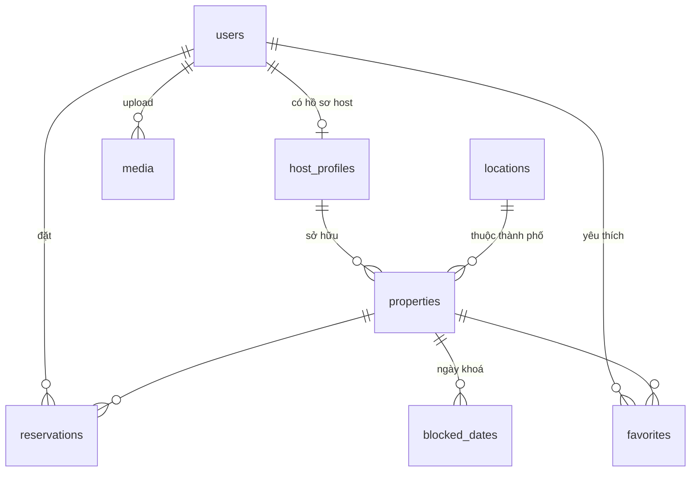

# Cơ sở dữ liệu

PostgreSQL 17, truy cập qua **Drizzle ORM**. Schema khai báo ở `web/lib/db/schema.ts`, migration SQL ở `web/drizzle/migrations/` (chỉ thêm, không sửa migration cũ).

- Tiền lưu **số nguyên cents**: giá căn hộ và mọi số tiền của đơn là **USD cents**; giá Workstation là **EUR cents**.
- Ngày lưu trú dùng kiểu `date` (không giờ); mốc thời gian dùng `timestamptz`.
- Trạng thái lưu dạng `varchar` với tập giá trị cố định (xem từng bảng), vòng đời ở [requirements.md](requirements.md#4-quy-tắc-nghiệp-vụ).

## Sơ đồ quan hệ



Các bảng nội dung (`workstation_*`, `travel_guides`, `blog_posts`, `community_videos`, `categories`, `settings`) đứng độc lập.

## Bảng

### `users`

| Cột | Kiểu | Ghi chú |
| --- | --- | --- |
| `id` | serial PK | |
| `email` | varchar(255) unique | |
| `password_hash` | varchar(255) | bcrypt |
| `first_name`, `last_name` | varchar(100) | |
| `role` | varchar(20) | `guest` \| `host` \| `admin`, mặc định `guest` |
| `is_active` | boolean | `false` = tài khoản bị khoá, không đăng nhập được |
| `created_at` | timestamptz | |

### `host_profiles`

Hồ sơ đối tác cho thuê, 1-1 với `users`.

| Cột | Kiểu | Ghi chú |
| --- | --- | --- |
| `id` | serial PK | |
| `user_id` | int unique → `users.id` | xoá user thì xoá hồ sơ (`cascade`) |
| `display_name`, `slug` | varchar | `slug` unique |
| `phone`, `website`, `cities`, `portfolio_size`, `bio`, `avatar` | | thông tin đơn đăng ký |
| `status` | varchar(20) | `pending` \| `approved` \| `rejected` \| `suspended` |
| `rejection_reason` | text | |
| `approved_at`, `created_at` | timestamptz | |

Index: `status`.

### `locations`

Thành phố / điểm đến.

| Cột | Kiểu | Ghi chú |
| --- | --- | --- |
| `id` | int PK | |
| `city`, `name`, `slug` | varchar | `slug` unique, dùng trong URL `/c/furnished-apartments-:slug` |
| `country`, `country_code`, `continent` | varchar | |
| `properties_count` | int | |
| `description` | text | HTML đã làm sạch |
| `image` | varchar(255) | |
| `center` | jsonb `[lat, lng]` | tâm bản đồ |
| `is_active` | boolean | ẩn/hiện toàn site |
| `position` | int | thứ tự; `1..8` = Top Cities trên trang chủ |

Index: `(is_active, position)`.

### `categories`

Danh mục căn hộ: `id`, `name`, `slug` (unique), `icon`, `description`, `position`.

### `properties`

| Cột | Kiểu | Ghi chú |
| --- | --- | --- |
| `id` | int PK | |
| `host_id` | int → `host_profiles.id` | |
| `reference` | varchar(50) unique | mã tin (vd `PS-16060`; tin mới tự sinh `ND-PROP-<id>`) |
| `title`, `slug`, `description` | | `slug` unique; `description` là HTML |
| `price_per_month` | int | USD cents |
| `currency` | varchar(10) | mặc định `USD` |
| `location_id` | int → `locations.id` | |
| `city`, `country`, `neighborhood`, `address` | varchar | |
| `bedrooms`, `bathrooms`, `beds_count`, `total_surface`, `max_guests` | int | |
| `kitchen`, `laundry`, `balcony`, `pet_friendly`, `pool`, `gym`, `terrace` | boolean | tiện ích |
| `workstation` | jsonb | `hasWorkstation`, `desk`, `chair`, `monitors`, `keyboard`, `wifiSpeed` |
| `house_rules` | text | HTML |
| `check_in_start`, `check_out` | varchar | vd `15:00`, `11:00` |
| `minimum_stay_nights` | int | mặc định 30 |
| `is_direct_booking` | boolean | `true` = Instant book, `false` = Request to book |
| `images` | jsonb `string[]` | ảnh đầu là ảnh bìa |
| `featured_position` | int null | có giá trị = căn nổi bật, theo thứ tự |
| `status` | varchar(20) | `draft` \| `pending_review` \| `published` \| `rejected` \| `hidden` |
| `rejection_reason` | text | |
| `created_at`, `updated_at` | timestamptz | |

Index: `host_id`, `location_id`, `(status, featured_position)`, `lower(city)`.

### `blocked_dates`

Khoảng ngày Host khoá lịch.

| Cột | Kiểu | Ghi chú |
| --- | --- | --- |
| `id` | serial PK | |
| `property_id` | int → `properties.id` | `cascade` |
| `start_date`, `end_date` | date | CHECK `end_date > start_date` |
| `reason` | varchar(150) | |

Index: `(property_id, start_date, end_date)`.

### `reservations`

| Cột | Kiểu | Ghi chú |
| --- | --- | --- |
| `id` | serial PK | |
| `code` | varchar(20) unique | mã đơn `ND-XXXXX` |
| `user_id` | int → `users.id` | người đặt |
| `property_id` | int → `properties.id` | |
| `move_in_date`, `move_out_date` | date | CHECK `move_out_date > move_in_date` |
| `nights` | int | |
| `monthly_rent`, `rent_amount`, `workstation_fee`, `total_amount`, `commission_amount`, `host_payout` | int | USD cents, tính lúc tạo đơn |
| `workstation_config` | jsonb | gói, linh kiện, phụ kiện đã chọn |
| `guest_name`, `guest_email`, `guest_phone` | varchar | |
| `status` | varchar(20) | `pending` \| `confirmed` \| `rejected` \| `expired` \| `cancelled` \| `completed` |
| `respond_by` | timestamptz | hạn Host phản hồi (đơn Request to book) |
| `rejection_reason` | varchar(255) | lý do từ chối / huỷ |
| `cancelled_by` | varchar(20) | `guest` \| `host` \| `admin` |
| `payment_status` | varchar(20) | `authorized` \| `captured` \| `voided` \| `refunded` |
| `payment_ref` | varchar(100) | mã giao dịch của payment driver |
| `commission_rate`, `respond_hours`, `free_cancel_days` | int | bản chụp quy tắc lúc tạo đơn |
| `created_at`, `updated_at` | timestamptz | |

Index: `user_id`, `(property_id, status)`, `(status, respond_by)`, `created_at`.

**Chống đặt trùng:** migration đầu bật extension `btree_gist` và thêm

```sql
ALTER TABLE reservations ADD CONSTRAINT exclude_overlapping_reservations
  EXCLUDE USING gist (property_id WITH =, daterange(move_in_date, move_out_date) WITH &&)
  WHERE (status IN ('pending', 'confirmed'));
```

Hai đơn `pending`/`confirmed` của cùng một căn không thể chồng ngày, kể cả khi hai request đến cùng lúc.

### `favorites`

`id`, `user_id` → `users.id` (`cascade`), `property_id` → `properties.id` (`cascade`), `created_at`. Unique `(user_id, property_id)`.

### `workstation_packages`, `workstation_components`, `workstation_addons`

| Bảng | Cột chính |
| --- | --- |
| `workstation_packages` | `slug` unique, `name`, `description`, `monthly_price_eur` (EUR cents), `is_included`, `features` jsonb, `is_active`, `position` |
| `workstation_components` | `component_id` unique, `name`, `category` (`desk` \| `chair` \| `monitor` \| `keyboardMouse`), `monthly_price_eur`, `options` jsonb, `is_active`, `position` |
| `workstation_addons` | `addon_id` unique, `name`, `category`, `description`, `monthly_price_eur`, `is_active`, `position` |

### `travel_guides`, `blog_posts`

Cùng dạng bài viết: `slug` unique, `title`, `excerpt`, `content` (HTML), `cover_image`, `category`, `status` (`draft` \| `published`), `seo_title`, `seo_description`, `position`, `created_at`. `travel_guides` có thêm `city`, `is_featured`; `blog_posts` có thêm `author`, `read_time`. Index `(status, position)`.

### `community_videos`

Reel cộng đồng ở trang chủ: `title`, `author`, `platform`, `video_url`, `embed_url`, `thumbnail_url`, `aspect`, `is_active`, `position`.

### `settings`

Key–value jsonb. Hiện dùng key `currency_rates` (tỷ giá EUR / GBP so với USD).

### `media`

Ảnh upload vào thư viện.

| Cột | Kiểu | Ghi chú |
| --- | --- | --- |
| `id` | serial PK | |
| `url` | varchar(255) unique | `/uploads/<32-hex>.webp` |
| `storage_key` | varchar(255) unique | tên file trong `UPLOAD_DIR` |
| `mime_type` | varchar(50) | luôn `image/webp` sau khi xử lý |
| `width`, `height`, `size_bytes` | int | |
| `alt` | varchar(255) | |
| `uploaded_by` | int → `users.id` | `set null` khi xoá user |

Index: `(uploaded_by, created_at)`. Một ảnh chỉ xoá được khi không còn bảng nào tham chiếu tới `url` của nó.

## Migration & seed

| Lệnh (trong `web/`) | Việc |
| --- | --- |
| `npm run db:generate` | Sinh migration mới từ `schema.ts` (drizzle-kit) |
| `npm run db:migrate` | Áp migration lên `DATABASE_URL` |
| `npm run db:seed` | Nạp dữ liệu mẫu từ `docs/seed/*.json`; chỉ chèn bản ghi còn thiếu, không ghi đè |
| `npm run db:verify-seed` | So số bản ghi từng bảng với dữ liệu mẫu |
| `npm run db:build-scripts` | Bundle 3 script trên thành JS (`dist/db/`) cho Docker image |

Trong Docker, container `web` tự chạy migrate rồi seed mỗi lần khởi động.
